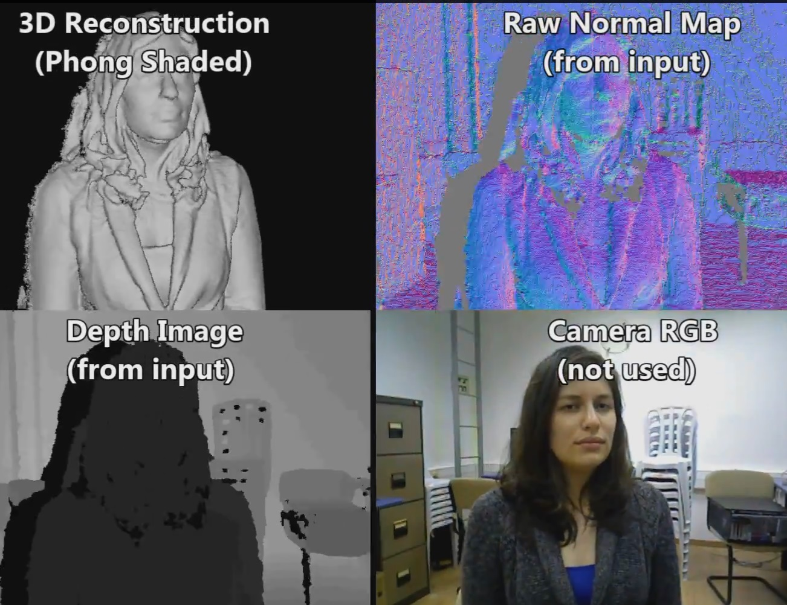

# OpenFusion

<p align="center">
  
</p>


A camera-agnostic implementation of KinectFusion using CUDA and OpenCV, with an abstract camera interface.

Students: Nurit Schwabsky, Vered Cohen.

Supervision: Aaron Wetzler and Chaim Gotsman. Later upstream code organization: Gil Ben-Shachar.

## Status

The [original 35-page project report](docs/report.pdf) has been recovered. The public [Gil Ben-Shachar upstream repository](https://github.com/gilbs10/OpenFusion) is included as the `source/` Git submodule, pinned to commit `8d435bfff054543c7e57274b773503b1370f90b4`. This preserves the original source and third-party notices rather than relabeling it as new code.

## Original code

[`source/`](https://github.com/gilbs10/OpenFusion/tree/8d435bfff054543c7e57274b773503b1370f90b4) is a Git submodule pointing to [gilbs10/OpenFusion](https://github.com/gilbs10/OpenFusion) at commit `8d435bfff054543c7e57274b773503b1370f90b4`. Its contents, including bundled third-party headers and notices, are the upstream's own files, unmodified by this archive. Clone with `--recurse-submodules` to populate it.

## Running

```sh
git clone --recurse-submodules https://github.com/twerdster/openfusion.git
cd openfusion
git submodule update --init --recursive
```

The recovered upstream uses CUDA, an NVIDIA GPU, Eigen, CImg, GLEW, GLUT, OpenGL, X11 and POSIX threads. Camera backends include file replay, OpenNI/PrimeSense and SoftKinetic/DepthSense. Camera SDKs and recordings must be supplied separately. The source contains hardcoded capture paths and sensor configuration.

The original CMake entry point is `source/Source/CMakeLists.txt`. For investigation in a compatible legacy Linux/CUDA environment:

```sh
cmake -S source/Source -B build -DBUILD_FROMFILE=ON
cmake --build build
```

These commands identify the original build entry point; they are **not a verified modern installation recipe**. The CMake file targets old CUDA architectures and SDK utilities. A current local CMake configuration attempt fails because compatibility with the declared CMake 2.6 minimum has been removed. CUDA hardware, legacy SDKs and depth recordings were not available for a runtime test. No source modifications have been made to conceal these limitations.

A 2014 handoff described an earlier Visual Studio 2010 / CUDA 5.5 setup. That is historical context, not a claim that a Visual Studio solution is present in this pinned upstream revision.

## Links

- [Project entry on Aaron Wetzler's website](https://twerdster.github.io/#openfusion)
- [Original source](https://github.com/gilbs10/OpenFusion)
- [Recovered project report](docs/report.pdf)

- [Project page](https://gip.cs.technion.ac.il/last-projects-2012-2.html)

## Attribution and Updates

Original student and third-party notices remain in the pinned upstream source. No overall license file was found there; no new source-code license is assigned by this archive. Original authors can open an issue to contribute updates or request corrections or removal of their material.

Figure provenance: `assets/project-preview.jpg` is the original student-project figure from the archived project page on Aaron Wetzler's website, copied without modification. It is a historical figure, not a new reconstruction result.

