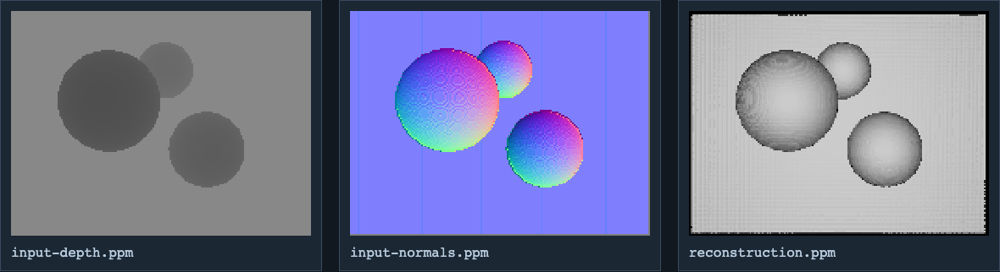
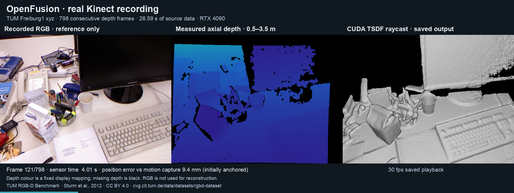

# OpenFusion

<p align="center">
  
</p>


OpenFusion implements a KinectFusion-style depth reconstruction pipeline. It converts calibrated depth frames to vertex and normal maps, estimates camera motion with iterative closest point (ICP), integrates observations into a truncated signed-distance volume (TSDF), and raycasts that volume. The original project explored GPU reconstruction from depth cameras. The updated implementation provides Linux file replay and a headless test/demo runner.

Students: Nurit Schwabsky and Vered Cohen. Supervision: Chaim Gotsman and Aaron Wetzler. The pinned upstream repository belongs to [Gil Ben-Shachar (`gilbs10`)](https://github.com/gilbs10). Maintenance changes are labeled as updated work; they are not presented as the students' original implementation.

*The figure above is archived project imagery. It was not produced by the updated runner.*

## Original and updated code

The [35-page project report](docs/report.pdf) and upstream [gilbs10/OpenFusion](https://github.com/gilbs10/OpenFusion) are preserved. The `source/` submodule remains at `8d435bfff054543c7e57274b773503b1370f90b4`, with its files and notices unchanged. Its camera abstraction includes file, OpenNI/PrimeSense, SoftKinetic/DepthSense and GIP backends; each implemented backend needs its vendor SDK and calibration.

The separately labeled [`updated/`](updated/README.md) implementation builds the reconstruction components without the original OpenGL interface or sensor SDKs. Depth conversion, normals, ICP correspondence reduction, TSDF integration and raycasting execute on CUDA. The small ICP normal-equation system is solved on the CPU using bundled Eigen headers. This is a port and targeted repair of the recovered pipeline.

## Build and run on Linux

Requirements are an NVIDIA GPU and working driver, a compatible CUDA toolkit/host compiler, CMake 3.18 or newer (the declared minimum; 3.22.1 was tested), and a C++17 compiler. Python 3 is optional for the saved-output viewer. The updated build uses bundled headers and does not require system Eigen, CImg, GLEW, GLUT or X11.

```sh
git clone --recurse-submodules https://github.com/twerdster/openfusion.git
cd openfusion
cmake -S updated -B build/updated -DCMAKE_BUILD_TYPE=Release
cmake --build build/updated --parallel 2
(cd build/updated && ctest --output-on-failure)
build/updated/openfusion_headless --demo --output openfusion-output
python3 updated/tools/view_demo.py openfusion-output/demo
```

Open `openfusion-output/demo/demo.html` to inspect saved images, replay the saved reconstruction frames, rotate the exported surface points and read measurements. Viewing this HTML does not execute CUDA. The demo generates a calibrated synthetic depth recording and processes it through file replay, tracking, fusion and raycasting.

The default volume is 512³ voxels across 1,024 mm: 2 mm per voxel. TSDF values and weights alone occupy about 640 MiB of GPU memory; working buffers and host copies need additional space. The [build guide](docs/BUILD.md) covers CUDA target selection, smaller volumes, recording layout and historical build options.

<p align="center">
  
</p>

*Saved output from the updated 512³ synthetic demo, not a camera recording. The [standalone viewer](updated/examples/demo.html) includes frame playback, surface points and recorded metrics; download the HTML to open it locally.*

## Real Kinect data

The published CUDA pipeline processed all 798 depth frames in the TUM Freiburg 1 xyz archive at 640 × 480 resolution (26.594 seconds of capture timestamps), completing all 797 ICP transitions without runtime changes. Offline motion-capture comparison matched 795 frames and rejected three timestamp associations. First-pose-anchored position RMSE was 29.501 mm, versus 238.979 mm for a stationary-pose baseline; orientation RMSE was 1.200°, versus 9.986° for the stationary baseline. Ground truth was used only after replay, to evaluate saved poses; it never initialized ICP. Camera trajectory accuracy does not establish surface accuracy, and the fixed one-metre cube covers only part of the room. See [real-data instructions, evidence and limitations](docs/REAL_DATA.md).

<p align="center">
  
</p>

*Frame 121 of the real-data run. RGB is reference only; depth is colour-mapped for display and the right panel is saved CUDA output. Dataset: Sturm et al., TUM RGB-D Benchmark, IROS 2012, [CC BY 4.0](https://cvg.cit.tum.de/data/datasets/rgbd-dataset#license). Preview composition and reconstruction are maintenance outputs.*

## What has been checked

The updated Linux code compiled and ran on Ubuntu 22.04 with GCC 11.4, CMake 3.22.1, CUDA 11.5.119, NVIDIA driver 570.211.01 and an RTX 4090. The initial run used `RelWithDebInfo`; an isolated clean `Release` build also passed all three CTest entries. The [validation record](updated/VALIDATION.json) and [saved logs](updated/validation/) identify the implementation and commands. Three CTest entries cover component regressions, the generated demo and file replay of its recording. They are not independent dataset trials or benchmarks.

Checks compare depth conversion, normals, correspondence normal equations and TSDF values against CPU references. They also exercise partial CUDA blocks, malformed replay files, known-motion and singular ICP cases, allocation guards and rejection of voxels behind the camera. Restoring the unmodified original integration kernel makes the guard regression fail. An instrumented original ICP reduction also fails the numerical reference when unused shared scratch is seeded with finite values; the updated reduction passes with equivalent instrumentation. This is an adversarial scratch experiment, not a claim of deterministic failure in every original run. The unchanged source remains preserved.

At 128³, Compute Sanitizer memcheck, racecheck, initcheck and synccheck each completed the component checks and demo with no reported errors or shared-memory race hazards. These diagnostics cover that configuration and execution path, rather than every input or the original GUI. Initcheck in this version checks global-memory initialization only.

The 12-frame, 193 × 145 synthetic replay contains three spheres in an asymmetric arrangement and a back plane. True final translation was 8.661 mm; the estimate moved 6.088 mm from its initial pose. At 512³, final pose error was 2.915 mm and 0.1772° (also the sequence maxima), compared with 8.661 mm translation error for a stationary-pose baseline. Surface RMSE grew from 0.807 to 1.995 mm; pose error also generally grew through this short sequence. Final raycasts hit 26,977 of 27,985 pixels, with 3,400 / 1,857 / 834 samples assigned within 5.5 mm of the three analytic sphere surfaces. These values do not establish accuracy on camera recordings.

The final same-ray range RMSE was larger, 14.414 mm, with 0.43% of hits exceeding 5.5 mm range error. The analytic first hit is evaluated at the estimated camera pose. The large-error tail is consistent with foreground/back-plane switches near silhouettes; outlier locations were not separately classified. The record retains both errors. The raycast normals also have a measured limitation: on the plane fixture, interior normals had a mean angular error of 25.09° relative to the analytic plane normal. Passing implementation-reference checks does not remove that geometric error.

## Limits

The updated runner is headless. The original GUI, live sensor backends and optional image filters have not been ported or validated. Real-data evidence covers one TUM recording. Other scenes and motion patterns, loop closure, tracking recovery and performance benchmarks remain unvalidated. The raycaster retains nearest-voxel sampling and a fixed 1.5 mm step; TSDF sampling and normals have visible discretization effects. A 128³ build is useful for smaller regression runs but has 8 mm voxels and substantial banding.

File replay uses `Parameters.txt` and numbered `recordedN` depth files, with optional `recorded-rgbN` files. These raw formats require matching dimensions, element types and calibration. Arbitrary depth images are not drop-in recordings. See [updated usage and validation](updated/README.md) before interpreting output.

## Attribution and terms

Student and third-party notices remain in the pinned source and derived updated files. No overall upstream license file was found; individual files may carry their own terms, and this wrapper grants no new source license. Authors can open an issue to contribute changes, correct attribution or request removal.

## Links

- [Project entry on Aaron Wetzler's website](https://twerdster.github.io/#openfusion)
- [Original source](https://github.com/gilbs10/OpenFusion)
- [Recovered project report](docs/report.pdf)
- [Historical project page](https://gip.cs.technion.ac.il/last-projects-2012-2.html)
