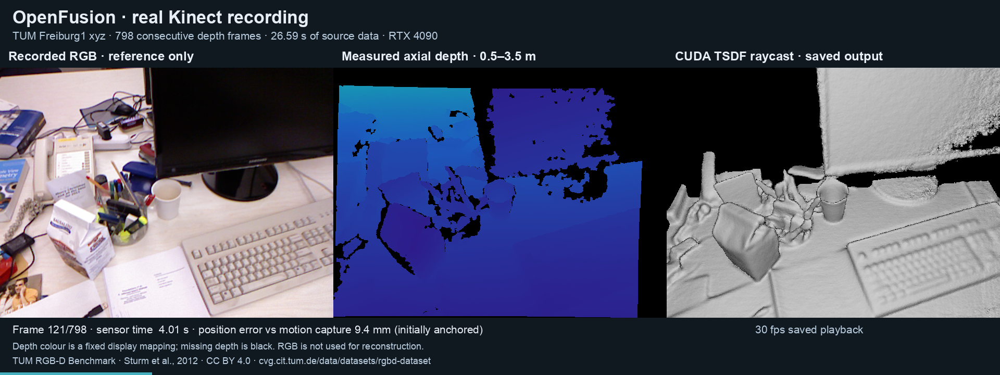

# OpenFusion

 

*Recorded TUM RGB/depth and reconstruction. The RGB image is for reference only, and the right panel is saved CUDA output. Dataset: Sturm et al., [CC BY 4.0](https://cvg.cit.tum.de/data/datasets/rgbd-dataset#license).*

OpenFusion was developed to reconstruct surfaces from a stream of depth-camera images using a KinectFusion-style pipeline.

Students: Nurit Schwabsky, Vered Cohen. The [report](docs/report.pdf) credits supervision by Chaim Gotsman and Aaron Wetzler. The upstream repository belongs to [Gil Ben-Shachar](https://github.com/gilbs10). Technion listed “Real Time 3D Surface Reconstruction” among the [2013 Amdocs Best Project Contest winners](https://www.cs.technion.ac.il/news/view-new.php?nwid=673), recognized at the 30 March 2014 ceremony. The reference explains how that announcement's supervisor credits differ from the report.

## Updated

[Open the interactive demo](https://twerdster.github.io/openfusion/). It reuses the saved synthetic 12-frame inspector, which lets you seek through saved raycasts and rotate point samples. It also links an animated excerpt of the real TUM run. No CUDA runs in the browser.

The Linux CUDA port performs depth preprocessing, normal estimation, ICP correspondence reduction, TSDF integration and raycasting on the GPU. It solves ICP's 6×6 system with Eigen on the CPU. It processed 798 recorded TUM Kinect frames. Against TUM motion capture, first-pose-anchored position RMSE was 29.501 mm, compared with 238.979 mm for a stationary baseline. No surface ground truth was available. Live sensors, the original GUI and runtime performance were not tested. See the [real-data notes](docs/REAL_DATA.md), the [validation summary](updated/VALIDATION.json) and the [logs](updated/validation/).

Requirements: Linux, an NVIDIA GPU and driver, a CUDA toolkit, CMake 3.18+, C++17 and the `source/` submodule. See [updated/README.md](updated/README.md) and [updated/DETAILS.md](updated/DETAILS.md).

## Original reference

The archival README is preserved in [ORIGINAL_PROJECT_REFERENCE.md](ORIGINAL_PROJECT_REFERENCE.md). The [original source](https://github.com/gilbs10/OpenFusion) is pinned unchanged. File notices remain, and no blanket license is assigned.
