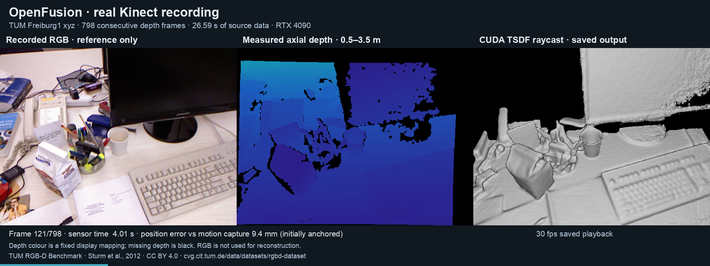

# Real Kinect recording: TUM Freiburg 1 xyz

The updated pipeline has also processed real Kinect depth images from the [TUM RGB-D benchmark](https://cvg.cit.tum.de/data/datasets/rgbd-dataset). The checked sequence is `rgbd_dataset_freiburg1_xyz`, obtained from the authors' [download page](https://cvg.cit.tum.de/data/datasets/rgbd-dataset/download). Runtime revision [fbbea81](https://github.com/twerdster/openfusion/tree/fbbea810e41b03dc9be90c61b87f9187d4d18a61/updated) was used without C++/CUDA changes; new Python tools convert the recording and evaluate its saved camera poses.

## Recorded scope

The completed run used all 798 depth frames listed in the downloaded archive, at 640 × 480 resolution, spanning 26.594 seconds of capture timestamps. No temporal stride, image downsampling, hole filling or additional depth scale correction was applied. All 797 ICP transitions completed. Offline evaluation matched 795 frames to motion capture. Recorded frames 202–204 were rejected for evaluation because their motion-capture bracketing samples have a 110.1 ms gap, exceeding the 20 ms endpoint limit; those depth frames still ran through reconstruction. These counts separate successful runtime processing from accepted trajectory ground truth.

| All 798 depth frames; 795 accepted pose pairs | Recorded value |
| --- | ---: |
| Position RMSE, first-pose anchored | 29.501 mm |
| Stationary-pose baseline position RMSE | 238.979 mm |
| Last matched / maximum position error | 34.028 / 56.751 mm |
| Orientation RMSE / stationary baseline | 1.200° / 9.986° |
| Separately fitted SE(3) position ATE, no scale fit | 17.421 mm |

These are camera trajectory errors against independent motion capture. There is no ground-truth surface scan in this check, so the reconstruction images and point cloud do not establish surface accuracy or completeness. The evaluator records `evaluated` and no accuracy pass threshold. The runner's `executed` status means its operator checks completed; it is not an accuracy grade.

The [runtime log](../updated/validation/tum-fr1-xyz/run-full.log), [saved poses](../updated/validation/tum-fr1-xyz/metrics-full.json), [evaluation](../updated/validation/tum-fr1-xyz/evaluation-full.json) and [independent crosscheck](../updated/validation/tum-fr1-xyz/independent-crosscheck.json) record this run. The crosscheck independently computes errors in TUM global coordinates without importing the evaluator; matched frame indices agree and position RMSE differs by less than 10⁻⁹ mm. This agreement checks evaluation arithmetic, not reconstruction accuracy.



The preview combines actual recorded frame 121 (1-based), associated RGB, depth and saved raycast output. RGB is not input to tracking or fusion. The [video provenance](../updated/validation/tum-fr1-xyz/video-provenance.json) records all 798 source/output frame mappings and hashes; [decode/visual checks](../updated/validation/tum-fr1-xyz/video-qa.json) and [pixel checks](../updated/validation/tum-fr1-xyz/video-pixel-qa.json) record the saved-video verification. The encoded video is not committed here; its hash and size are recorded. Playback at 30 frames per second is a presentation of saved output, not a measured processing rate. TUM data credit and transformations are listed below.

## Reproduce conversion, execution and evaluation

Download the [official archive](https://webshare.cvg.cit.tum.de/g/rgbd/dataset/freiburg1/rgbd_dataset_freiburg1_xyz.tgz) to a data directory with sufficient space. The checked file is 448,204,271 bytes, SHA-256 `a0236d97b8c30cd93b653656d2b6c293ff7c982a4130ef2a1a8beecdb124ef98`. Raw archives and converted frames are not committed. Use a native filesystem for the environment and build directory; ordinary archive/data storage can be elsewhere.

After the [Linux build](BUILD.md), use Python 3.10 or newer and install the converter/evaluator dependencies into a separate environment:

```sh
python3 -m venv .venv-tum
.venv-tum/bin/python -m pip install numpy pillow
.venv-tum/bin/python updated/tools/convert_tum.py \
  /path/to/rgbd_dataset_freiburg1_xyz.tgz /path/to/tum-recording \
  --start 0 --frames 798 --stride 1 --downsample 1
build/updated/openfusion_headless \
  --recording /path/to/tum-recording --frames 798 --output real-tum-output
.venv-tum/bin/python updated/tools/evaluate_tum.py \
  --recording /path/to/tum-recording \
  --metrics real-tum-output/replay/metrics.json \
  --output real-tum-output/trajectory-evaluation.json
```

The [run metadata](../updated/validation/tum-fr1-xyz/record.json) records package versions and the aliases used when retaining raw record files in this repository. The converter requires a new output directory. It accepts an extracted dataset directory or the TGZ archive, records source timestamps and hashes in `manifest.json`, and copies ground truth for subsequent evaluation. Associated RGB PNGs are retained for previews; RGB is not used by the reconstruction operators. The evaluator also writes an estimated trajectory in TUM text format.

The Python tooling has six conversion checks and nine trajectory-evaluation checks using small constructed inputs. They cover units, selected frame/index handling, file safety, coordinate transforms, timestamp association and errors. They are tool regressions, not 15 camera sequences. Run them with the same environment:

```sh
.venv-tum/bin/python -m unittest discover -s updated/tests -p 'test_tum_*.py'
```

## Units, calibration and coordinates

The import follows the authors' [format and calibration notes](https://cvg.cit.tum.de/data/datasets/rgbd-dataset/file_formats). Stored depth is converted to integer millimetres as `round(raw_uint16 / 5)`; zero remains invalid. The dataset's existing depth correction is not applied again. Default intrinsics are 525 / 525 / 319.5 / 239.5, without additional undistortion of registered depth. The converter writes negative focal lengths for OpenFusion's negative-camera-z convention.

For offline comparison, let `C = diag(1, 1, -1, 1)`. Each expected pose is `Tinit * C * inverse(TUM0) * TUMi * C`, with translations converted from metres to millimetres and `Tinit` placing the camera at world z = 768 mm. The motion-capture pose interpolated at the first depth timestamp fixes the coordinate origin and orientation; later ground truth never initializes or updates ICP. The primary error has no fitted trajectory transform or scale. A separately labeled position-only SE(3) alignment is also reported and must not replace the first-pose-anchored result.

Motion-capture translation is linearly interpolated and orientation uses quaternion interpolation at each depth timestamp. Both bracketing samples must be within 0.02 seconds; extrapolation and unmatched samples are rejected and counted. The stationary baseline holds the initialized camera pose throughout. The evaluator rejects invalid or substantially nonorthogonal saved pose matrices; its orientation angle uses the nearest proper rotation for accepted float matrices.

## Limits and attribution

The fixed 1,024 mm cube is centered at the reconstruction origin. The room extends outside it, so output covers only part of the observed scene. There is no volume shifting, relocalization or loop closure. This is one predominantly translational recording, with up to 22° rotation from the initial orientation. It does not establish arbitrary motion, other camera calibration, live sensor operation or benchmark performance.

Dataset credit: Jürgen Sturm, Nikolas Engelhard, Felix Endres, Wolfram Burgard and Daniel Cremers, *A Benchmark for the Evaluation of RGB-D SLAM Systems*, IROS 2012. The current [dataset license](https://cvg.cit.tum.de/data/datasets/rgbd-dataset#license) is CC BY 4.0 unless otherwise stated. Depth-to-millimetre conversion, reconstruction, evaluation and preview composition are maintenance transformations, not outputs supplied by the dataset authors. Dataset terms are separate from the recovered code's individual source notices.

For a dataset closer to the KinectFusion research lineage, the HCI [capture tools and example data](https://zenodo.org/records/8032815) provide raw Kinect files and OpenNI recordings for the 2012 follow-up *When Can We Use KinectFusion for Ground Truth Acquisition?* That archive was located but not downloaded or executed here. It is not identified as the original 2011 KinectFusion paper's recording.
