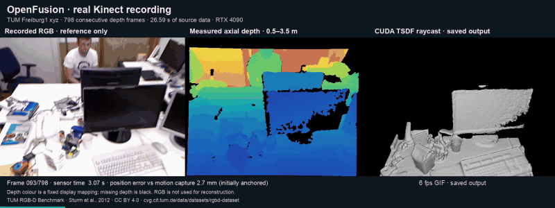

# Updated OpenFusion



*Excerpt from the real Kinect TUM Freiburg 1 xyz run. RGB is reference only; the other panels show measured depth and saved CUDA output. Saved playback is not a processing-speed measurement. Dataset: Sturm et al., IROS 2012, [CC BY 4.0](https://cvg.cit.tum.de/data/datasets/rgbd-dataset#license). [Data and preview details](../docs/REAL_DATA.md).*

This is the 2026 Linux headless port. It reads calibrated depth frames, estimates camera motion with ICP, integrates a TSDF volume and raycasts the reconstruction. CUDA computes depth/normal maps, ICP correspondences, integration and raycasting; CPU Eigen solves ICP's 6 × 6 system.

The recovered original is unchanged in `../source/` at `8d435bfff054543c7e57274b773503b1370f90b4`. Derived files retain their notices. This updated work is separate from the students' original implementation; see [attribution and terms](../README.md#attribution-and-terms).

## Build and run

Use Linux, an NVIDIA GPU/driver, a compatible CUDA toolkit/host compiler, C++17 and CMake ≥3.18. CMake 3.22.1 was tested. No system Eigen or display libraries are needed. Python 3 is optional for the saved-output viewer; TUM import/evaluation additionally needs Python 3.10+, NumPy and Pillow.

From the repository root:

```sh
git submodule update --init
cmake -S updated -B build/updated -DCMAKE_BUILD_TYPE=Release
cmake --build build/updated --parallel 2
(cd build/updated && ctest --output-on-failure)
build/updated/openfusion_headless --demo --output openfusion-output
python3 updated/tools/view_demo.py openfusion-output/demo
```

Choose the runner mode:

- `--self-test`: GPU component regressions against CPU references.
- `--demo`: generate and reconstruct the moving synthetic scene.
- `--recording DIR --frames N`: reconstruct a compatible recording.

`--output DIR` selects the output directory. With no mode selected, self-test and demo both run. CTest runs three entries: component checks, synthetic demo and replay of that generated recording. They are not three independent datasets. See [build and recording instructions](../docs/BUILD.md) for format, calibration, CUDA targets and resource requirements.

## Recorded results

The updated CUDA pipeline, with no recording-specific changes, processed all 798 TUM Freiburg 1 xyz depth frames at 640 × 480, completing 797 ICP transitions. Capture timestamps span 26.594 seconds. Offline evaluation accepted 795 motion-capture pairs; three associations were rejected because of a motion-capture gap.

First-pose-anchored position RMSE was **29.501 mm**, versus **238.979 mm** for a stationary pose. Orientation RMSE was **1.200°**, versus **9.986°** stationary. Ground truth is used after replay for evaluation, never to initialize ICP. These measurements describe camera tracking in one recording; no surface scan was available to measure reconstruction accuracy. [Real-data reproduction and evidence](../docs/REAL_DATA.md) and [detailed validation notes](../docs/VALIDATION.md) retain the methods, failures, synthetic thresholds and sanitizer scope.

## Output and limits

Under the chosen output directory, `demo/` or `replay/` contains PPM images, JSON records and `surface.ply`—raycast surface points and normals, not a mesh. The viewer creates `demo.html` for saved-frame playback and point-cloud rotation; viewing it does not execute CUDA. Generic replay records `executed`, not an accuracy pass; independent trajectory evaluation is separate.

The default 512³ volume spans 1,024 mm at 2 mm per voxel and clips the larger room. Nearest-voxel raycasting retains banding and normal errors. This target does not include live sensor input, the original GUI, optional filters, volume shifting, tracking recovery or loop closure. No throughput benchmark was run. The [validation notes](../docs/VALIDATION.md) explain those limits and the coarse 128³ checks.
