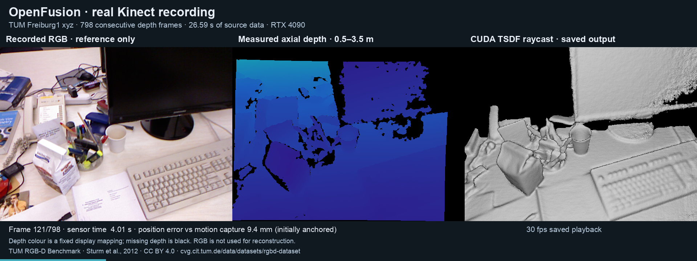

# OpenFusion — updated work

<a id="updated-and-ported-for-modern-hardware"></a>

## Updated work

The browser inspector displays saved raycast frames and point samples from the 12-frame synthetic run and links a separate real TUM output preview. It does not execute CUDA. The Linux headless port processed the real 798-frame recording; its measured camera-pose comparison is separate from unavailable surface ground truth.

**[Run the browser demo](https://twerdster.github.io/openfusion/)** · [Browser demo source and local use](../demo/README.md)



## Run locally

The static demo was checked in current Chrome and needs no package installation. From the repository root:

```sh
python3 -m http.server 8000 --directory demo
```

Open http://localhost:8000. The browser displays saved reconstruction output; it does not execute reconstruction.

## CUDA reconstruction

The Linux CUDA port performs depth preprocessing, normal estimation, ICP correspondence reduction, TSDF integration and raycasting on the GPU. It solves ICP's 6×6 system with Eigen on the CPU. It processed 798 recorded TUM Kinect frames. Recorded position RMSE was 29.501 mm, compared with 238.979 mm for a stationary baseline. No surface ground truth was available. There are no claims about live sensors, the GUI or performance. See the [real-data notes](../docs/REAL_DATA.md), the [validation summary](VALIDATION.json) and the [logs](validation/).

Requirements: Linux, an NVIDIA GPU and driver, a CUDA toolkit, CMake 3.18+, C++17 and the `source/` submodule. See the [detailed implementation, setup and validation guide](DETAILS.md).


[Previous archive README](../ORIGINAL_PROJECT_REFERENCE.md) · [Detailed conversion and validation notes](DETAILS.md) · [Browser data provenance](../demo/provenance.json).
